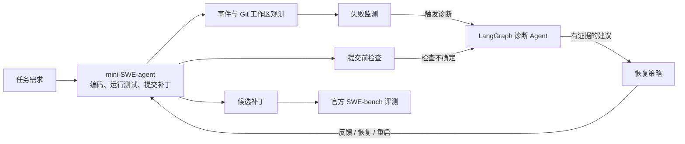

# Diagnostic SWE Agent

> 给 mini-SWE-agent 加上一位独立的诊断同伴：在编码过程受阻时收集证据、分析原因，并把可执行的下一步交还给编码 Agent。

Diagnostic SWE Agent 是一个基于 [mini-SWE-agent](https://mini-swe-agent.com/) 的软件工程任务实验项目。mini-SWE-agent 负责阅读需求、修改代码和运行命令；附加的诊断 Agent 在出现可观察的失败信号时介入，帮助区分代码实现、验证方式、运行环境和执行流程中的问题。项目同时保存完整运行轨迹，支持使用官方 SWE-bench 评测结果进行配对比较。

**项目提供：**

- **按证据触发诊断**：观察命令结果、测试失败与工作区变化，在需要时启动独立诊断。
- **LangGraph 诊断流程**：收集上下文、判断问题类别、运行受限的只读取证、生成附有证据的报告。
- **可控恢复**：根据报告向编码 Agent 提供反馈，或在隔离任务环境中恢复工作区、重新开始一次尝试。
- **可复现实验**：冻结任务清单，保存补丁、事件和诊断报告，并通过官方 SWE-bench harness 评分。

## 工作方式



编码 Agent 与诊断 Agent 使用独立上下文。诊断 Agent 接收任务描述、候选补丁、原始事件和受限的只读取证结果；它不会继承编码 Agent 的完整对话，也不会读取同一轮任务的官方隐藏测试结果。诊断报告需要引用本轮触发事件及其证据，证据不足时可以不给出恢复动作。

### 诊断 Agent 的 LangGraph 流程

1. **缩小范围**：根据触发信号筛选可能的问题类别。
2. **分类**：结合任务、事件和补丁判断当前阻塞点；不确定时保留 `unknown`。
3. **只读取证**：按类别查看必要的信息，例如 Git 状态、补丁格式或失败测试的上下文。
4. **形成假设**：对照任务要求与实际修改，提出能够被下一步测试验证的解释。
5. **生成报告**：输出问题类别、引用的证据、建议动作和恢复方式，由独立的恢复策略决定是否执行。

### 何时介入

| 信号 | 诊断目的 |
| --- | --- |
| 编码 Agent 明确请求帮助 | 处理它主动暴露的阻塞点 |
| 修改代码后测试失败，或同类失败再次出现 | 判断是补丁问题、验证不足，还是环境问题 |
| 工具连续报错、同一失败命令反复执行 | 找出执行条件或工作方式上的阻塞 |
| 多轮命令没有带来新进展 | 帮助调整下一步行动 |
| 提交前缺少可确认任务行为的聚焦测试 | 检查需求与补丁之间是否仍有具体的验证缺口 |

监测器只决定**何时值得诊断**；它不会把一次失败直接判为代码错误。提交前审查也允许诊断 Agent 在没有具体缺口时放行补丁。

### 诊断类别与处理方式

| 类别 | 常见问题 | 典型诊断措施 |
| --- | --- | --- |
| 需求理解 `understanding` | 对目标行为或约束的理解有偏差 | 重新对照需求、现有行为和补丁范围 |
| 问题定位 `localization` | 修改未触及真正的故障路径 | 查找相关代码、调用关系与失败测试 |
| 代码实现 `implementation` | 补丁未覆盖边界条件或引入回归 | 检查差异与失败断言，建议最小修复和复测 |
| 测试验证 `verification` | 现有检查无法证明要求已满足 | 指出未验证的行为，建议聚焦测试 |
| 运行环境 `environment` | 依赖、测试工具或容器条件异常 | 核对版本与错误证据，在原始代码上复测疑点 |
| 执行流程 `control_flow` | 重复无效操作或尝试停滞 | 调整行动顺序，必要时建议恢复或重启 |

恢复策略支持 `feedback`、`restore`、`restart` 和 `none`。反馈会交给原编码 Agent 继续工作；恢复和重启只用于允许重置的隔离任务环境，并先保存候选补丁。诊断建议本身不等于测试通过。

## 先导实验

在一次选取 **23 个 SWE-bench Lite `dev` 任务**的先导对照中，直接运行 mini-SWE-agent 后识别出 **1 个值得诊断介入的代码任务**：`pylint-dev__astroid-1978`。启用诊断后，该任务产生了诊断反馈与后续修改；最终提交补丁在官方 SWE-bench 评测中标记为 **`resolved`**。

这是一个小规模案例结果，说明诊断链路能够在这道任务中发挥作用；它不代表 23 题总体解决率的提升，也不能单凭这道题推断对未见任务的泛化效果。该结果来自提交前审查机制通用化之前的一次运行；当前实现已通过本地回归测试，仍需重新运行官方评测。比较不同运行方式时，应使用相同的任务清单、模型配置与评测镜像，并以官方 harness 的逐题报告为准。

## 快速开始

需要 **Python 3.11+**。运行真实 SWE-bench 任务还需要模型 API、Docker、可用的 SWE-bench 镜像；官方评分需在同一 Python 环境中安装 SWE-bench harness。完整环境搭建与原版 mini-SWE-agent 对照命令见 [TESTING.md](TESTING.md)。

```bash
python3 -m venv .venv
.venv/bin/python -m pip install -e .
.venv/bin/python -m unittest discover -s tests -q
```

先固定任务，再运行带诊断的编码 Agent。`MODEL` 和 `DIAG_MODEL` 使用模型服务提供方支持的名称，并按其要求配置 API 密钥：

```bash
export MODEL='provider/main-model'
export DIAG_MODEL='provider/diagnosis-model'

.venv/bin/diagnostic-swe prepare \
  --dataset lite --split dev --limit 1 \
  --output experiments/smoke.json

.venv/bin/diagnostic-swe run \
  --manifest experiments/smoke.json \
  --variant full \
  --model "$MODEL" --diagnosis-model "$DIAG_MODEL" \
  --output experiments/smoke-diagnostic
```

`experiments/smoke-diagnostic/predictions.jsonl` 保存供官方评测的补丁；`tasks/` 保存每题的运行轨迹、事件和诊断报告。输出目录必须使用新路径，避免覆盖已有实验。

在具备 Docker 的评测主机上安装 SWE-bench harness，并使用新的 `run-id` 执行官方评测：

```bash
git clone https://github.com/SWE-bench/SWE-bench.git ../SWE-bench
.venv/bin/python -m pip install -e ../SWE-bench

.venv/bin/diagnostic-swe evaluate \
  --manifest experiments/smoke.json \
  --predictions experiments/smoke-diagnostic/predictions.jsonl \
  --run-id smoke-diagnostic-001 \
  --output experiments/official --workers 1
```

官方汇总位于 `experiments/official/logs/evaluation/smoke-diagnostic-001/results.json`。若要分析已有的逐题评测日志，可运行 `diagnostic-swe audit`；若已运行原版 mini-SWE-agent 的相同任务，可用 `diagnostic-swe compare` 做配对比较。`run` 还提供 `no-diagnosis` 和 `no-recovery` 消融选项；它们仍保留提交前检查，因此**不等同于原版 mini-SWE-agent**。

## 实验记录与开发

- [TESTING.md](TESTING.md)：完整的运行、官方评分和配对比较步骤。
- 本地测试：`.venv/bin/python -m unittest discover -s tests -q`。

欢迎基于新的任务集合验证触发规则、诊断建议和恢复策略。评测结果应同时报告任务选择、模型与镜像配置，以及原版 mini-SWE-agent 的对应结果。
